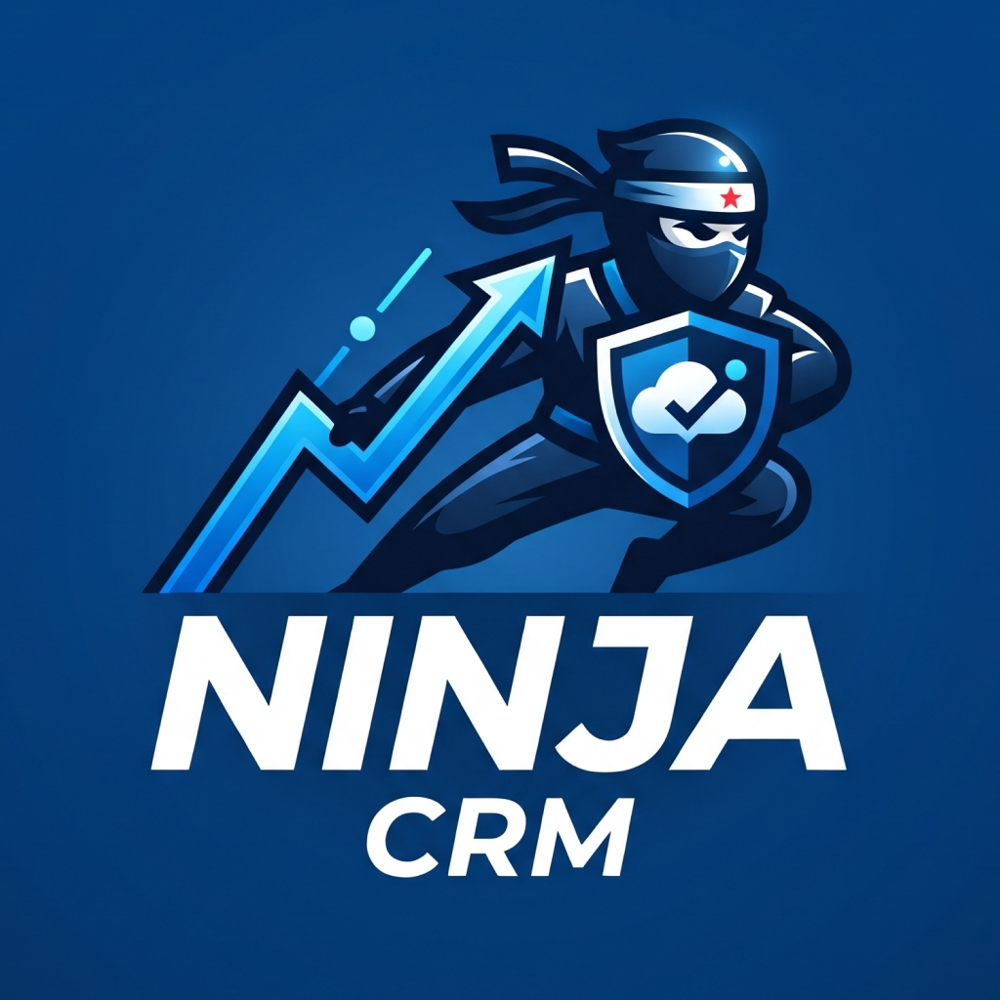
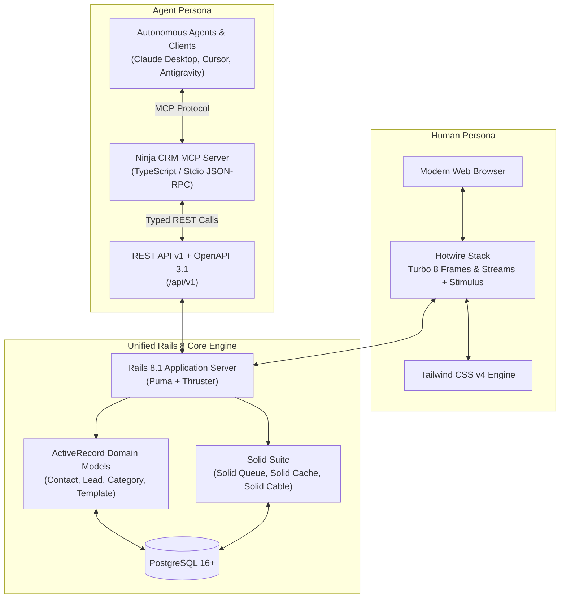

<p align="center">
  
</p>

<h1 align="center">Ninja CRM</h1>

<p align="center">
  <a href="https://rubyonrails.org/"></a>
  <a href="https://www.ruby-lang.org/"></a>
  <a href="https://www.postgresql.org/"></a>
  <a href="https://tailwindcss.com/"></a>
  <a href="https://hotwired.dev/"></a>
  <a href="public/api/v1/openapi.json"></a>
  <a href="https://modelcontextprotocol.io/"></a>
  <a href="https://github.com/leouofa/ninja-crm-mcp"></a>
  <a href="test/"></a>
  <a href="LICENSE"></a>
</p>

<p align="center">
  <strong>The MCP-first CRM engine built with Ruby on Rails 8, engineered from the ground up for autonomous AI agents and modern human teams.</strong>
</p>

Ninja CRM pairs a high-velocity, reactive Hotwire web application with an agentic-optimized backend specifically architected to serve as the high-fidelity state engine for its companion Model Context Protocol server, [**`ninja-crm-mcp`**](https://github.com/leouofa/ninja-crm-mcp).

---

## The Dual-Persona Paradigm

Traditional Customer Relationship Management systems are architected strictly for human clickpaths through dense web portals, with programmatic APIs bolted on as an afterthought. Conversely, pure "headless" databases lack human observability and intuitive visual controls.

Ninja CRM bridges this divide with a **Dual-Persona Architecture**:



1. **For Humans**: A lightning-fast, zero-build-step web experience powered by Rails 8, Hotwire (Turbo 8, Turbo Frames, Stimulus), Propshaft, and Tailwind CSS v4. Lead pipelines, contacts, and outreach templates update seamlessly without full-page reloads.
2. **For Autonomous Agents**: A purpose-built REST API (`/api/v1/`) and OpenAPI 3.1 specification designed specifically to eliminate token waste, roundtrip latency, and schema hallucination when operated by autonomous LLMs through [**`ninja-crm-mcp`**](https://github.com/leouofa/ninja-crm-mcp).

---

## Agentic & API Engineering: Why "MCP-First"?

Most REST APIs degrade severely when consumed by autonomous agents. They require multiple roundtrips to assemble relational data, reject payloads over rigid root-key conventions, or swamp the model's context window with bulky metadata envelopes.

Ninja CRM solves these core agentic bottlenecks at the Rails architecture level:

### 1. Zero-Hop Association Sideloading
Standard RESTful APIs adhere to strict resource isolation: fetching a lead yields only foreign keys (`contact_id`, `category_id`), forcing an LLM to spend 2 to 3 subsequent tool turns retrieving related records.

Ninja CRM automatically sideloads full associated objects within lead and template responses:

```json
{
  "id": 42,
  "status": "in_progress",
  "notes": "Met at DevConf. Interested in enterprise tier.\n[2026-11-20 03:15:00 UTC] Status changed to in_progress",
  "contact": {
    "id": 12,
    "name": "Sarah Connor",
    "email": "sarah@cyberdyne.com",
    "company": "Cyberdyne Systems",
    "role": "Head of Security",
    "linkedin_url": "https://linkedin.com/in/sarahconnor"
  },
  "category": {
    "id": 3,
    "name": "Enterprise Inbound"
  },
  "created_at": "2026-11-19T20:00:00.000Z",
  "updated_at": "2026-11-20T03:15:00.000Z"
}
```
*Result: An agent receives complete multi-entity context in a single tool invocation.*

### 2. Permissive Root-Key Deserialization
Different LLMs and tool calling frameworks format JSON payloads inconsistently—sometimes nesting parameters under root model keys (`{ "contact": { "name": "Jane" } }`) and other times flattening them at the payload root (`{ "name": "Jane" }`).

Ninja CRM's `Api::V1::BaseController` inspects and handles both structures transparently:

```ruby
# app/controllers/api/v1/contacts_controller.rb
def contact_params
  raw = params.key?(:contact) ? params.require(:contact) : params
  raw.permit(:name, :email, :phone, :company, :role, :linkedin_url, :notes)
end
```
*Result: Eliminates unforced 400/422 validation rejections caused by LLM payload format variations.*

### 3. Lean HTTP Header Pagination
Instead of cluttering the JSON response body with metadata wrappers that consume valuable LLM context window tokens, pagination state is transmitted purely via standard HTTP headers:

| Header | Description |
| :--- | :--- |
| `X-Total-Count` | Total records matching the filter criteria |
| `X-Limit` | Page size limit applied |
| `X-Offset` | Current pagination offset |

*Result: The response body contains pure, unpolluted domain arrays.*

### 4. Deterministic State Transitions with Auto-Auditing
Pipeline status transitions (`backlog` ➔ `in_progress` ➔ `done` ➔ `archived`) automatically append UTC-timestamped audit entries directly to the lead's activity history notes, ensuring an autonomous agent cannot perform silent or untracked state mutations.

### 5. Single-Source OpenAPI 3.1 Contract
The entire API is specified via OpenAPI 3.1 (`/public/api/v1/openapi.json`), serving as the deterministic contract that drives the TypeScript MCP server's compile-time types and runtime Zod validation schemas.

---

## Ecosystem: The Companion MCP Server

Ninja CRM is engineered to pair directly with [**`leouofa/ninja-crm-mcp`**](https://github.com/leouofa/ninja-crm-mcp), providing an out-of-the-box MCP interface over stdio:

- **23 Specialized MCP Tools**:
  - **Contacts (5)**: `ninja_crm_list_contacts`, `ninja_crm_get_contact`, `ninja_crm_create_contact`, `ninja_crm_update_contact`, `ninja_crm_delete_contact`
  - **Leads (5)**: `ninja_crm_list_leads`, `ninja_crm_get_lead`, `ninja_crm_create_lead`, `ninja_crm_update_lead`, `ninja_crm_delete_lead`
  - **Categories (5)**: `ninja_crm_list_categories`, `ninja_crm_get_category`, `ninja_crm_create_category`, `ninja_crm_update_category`, `ninja_crm_delete_category`
  - **Templates (5)**: `ninja_crm_list_templates`, `ninja_crm_get_template`, `ninja_crm_create_template`, `ninja_crm_update_template`, `ninja_crm_delete_template`
  - **Domain Workflows (3)**:
    - `ninja_crm_update_lead_status`: Validates transitions and logs audit stamps.
    - `ninja_crm_draft_outreach`: Merges contact details, lead notes, and template text with variable substitution (`{{contact_name}}`, `{{company}}`, `{{role}}`).
    - `ninja_crm_get_stats`: Computes live aggregate pipeline velocity and stage distribution.
- **5 MCP Live Resources**:
  - `ninja-crm://stats`: Real-time pipeline volume metrics.
  - `ninja-crm://leads/active`: Real-time feed of open pipeline items.
  - `ninja-crm://leads/{status}`: Parameterized stage views.
  - `ninja-crm://categories`: Category index and template coverage.
  - `ninja-crm://templates`: Outreach template library.
- **Dynamic Prompt Synchronization**:
  - Automatically synchronizes saved category outreach templates into native MCP prompts at runtime.

---

## Core Application Domain

| Entity | Description | Capabilities |
| :--- | :--- | :--- |
| **Leads** | Core pipeline progression item | Status transitions (`backlog`, `in_progress`, `done`, `archived`), category tagging, contact association, timestamped notes. |
| **Contacts** | People and prospects | Name, email, phone, company, role, LinkedIn URL, biographical notes. Unique 1-to-1 lead association. |
| **Categories** | Segmentation taxonomy | Custom vertical classifications with unique name indexing. |
| **Templates** | Outreach email/message templates | Category-bound reusable message structures with dynamic placeholder replacement. |

---

## Technology Stack

- **Framework**: [Ruby on Rails 8.1](https://rubyonrails.org/)
- **Language**: [Ruby 3.4+](https://www.ruby-lang.org/)
- **Database**: [PostgreSQL 16+](https://www.postgresql.org/) with relational integrity and foreign key constraints
- **Frontend Architecture**: [Hotwire](https://hotwired.dev/) (Turbo 8 + Stimulus) with zero JavaScript bundling step
- **Asset Pipeline**: [Propshaft](https://github.com/rails/propshaft)
- **Styling**: [Tailwind CSS v4](https://tailwindcss.com/)
- **Background & Caching**: [Solid Queue](https://github.com/rails/solid_queue), [Solid Cache](https://github.com/rails/solid_cache), [Solid Cable](https://github.com/rails/solid_cable)
- **Production Acceleration**: [Thruster](https://github.com/basecamp/thruster/) (HTTP asset caching, compression, and X-Sendfile)
- **Containerization & Deployment**: Docker + [Kamal 2](https://kamal-deploy.org/)
- **API Specification**: OpenAPI 3.1 (`/openapi.json`)

---

## REST API Reference

All programmatic API endpoints are scoped under `/api/v1/`:

| Method | Endpoint | Description | Query Filters / Params |
| :--- | :--- | :--- | :--- |
| `GET` | `/api/v1/contacts` | List & search contacts | `q`, `sort`, `order`, `limit`, `offset` |
| `POST` | `/api/v1/contacts` | Create contact | `name`, `email`, `phone`, `company`, `role`, `notes` |
| `GET` | `/api/v1/contacts/:id` | Get contact (includes lead) | — |
| `PATCH/PUT` | `/api/v1/contacts/:id` | Update contact | `name`, `email`, `phone`, `company`, `role`, `notes` |
| `DELETE` | `/api/v1/contacts/:id` | Delete contact | — |
| `GET` | `/api/v1/leads` | List & filter leads | `status`, `category_id`, `contact_id`, `q`, `limit`, `offset` |
| `POST` | `/api/v1/leads` | Create lead | `contact_id`, `category_id`, `status`, `notes` |
| `GET` | `/api/v1/leads/:id` | Get lead (sideloaded contact & category) | — |
| `PATCH/PUT` | `/api/v1/leads/:id` | Update lead or status | `status`, `category_id`, `notes` |
| `DELETE` | `/api/v1/leads/:id` | Delete lead | — |
| `GET` | `/api/v1/categories` | List categories | `q`, `sort`, `order`, `limit`, `offset` |
| `POST` | `/api/v1/categories` | Create category | `name` |
| `GET` | `/api/v1/categories/:id` | Get category | — |
| `PATCH/PUT` | `/api/v1/categories/:id` | Update category | `name` |
| `DELETE` | `/api/v1/categories/:id` | Delete category | — |
| `GET` | `/api/v1/templates` | List templates | `category_id`, `limit`, `offset` |
| `POST` | `/api/v1/templates` | Create template | `category_id`, `body` |
| `GET` | `/api/v1/templates/:id` | Get template (sideloaded category) | — |
| `PATCH/PUT` | `/api/v1/templates/:id` | Update template | `body` |
| `DELETE` | `/api/v1/templates/:id` | Delete template | — |

---

## Quickstart & Local Development

> [!TIP]
> **Prefer running with Docker?** You can run the entire development stack (Rails on port 3012, Solid Queue background jobs, Tailwind watcher, and PostgreSQL with pgvector) in Docker Compose:
> ```sh
> docker compose up -d --build
> ```
> See [docs/DOCKER.md](docs/DOCKER.md) for full details, Tailscale access, volume persistence, and everyday commands.

### Prerequisites

- **Ruby**: `3.4.0` or higher (compatible with `3.3+`)
- **PostgreSQL**: `14+` running locally
- **Bundler**: `gem install bundler`

### Setup

1. **Clone the repository**:
   ```bash
   git clone https://github.com/leouofa/ninja-crm.git
   cd ninja-crm
   ```

2. **Install dependencies and prepare the database**:
   ```bash
   bin/setup
   ```

3. **Start the development server** (Rails + Tailwind watch process):
   ```bash
   bin/dev
   ```
   Open [http://localhost:3000](http://localhost:3000) to view the web dashboard.

4. **Verify the test suite**:
   ```bash
   bin/rails test
   ```
   *Expected output: 90 tests, 370 assertions, 0 failures, 0 errors.*

### Connecting the MCP Server

With Ninja CRM running on `http://localhost:3000`, clone and build the companion MCP server:

```bash
git clone https://github.com/leouofa/ninja-crm-mcp.git
cd ninja-crm-mcp
npm install && npm run build
```

Configure your MCP host (Claude Desktop, Cursor, or Antigravity):

```json
{
  "mcpServers": {
    "ninja-crm": {
      "command": "node",
      "args": ["/path/to/ninja-crm-mcp/dist/index.js"],
      "env": {
        "NINJA_CRM_API_URL": "http://localhost:3000"
      }
    }
  }
}
```

---

## License

This project is licensed under the [MIT License](LICENSE).
